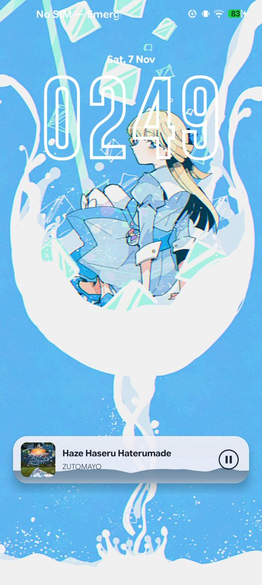
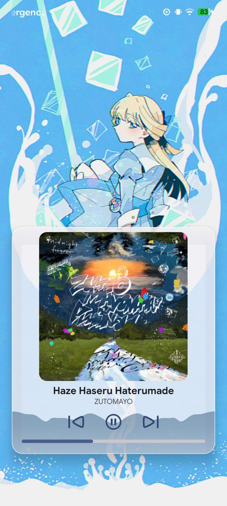
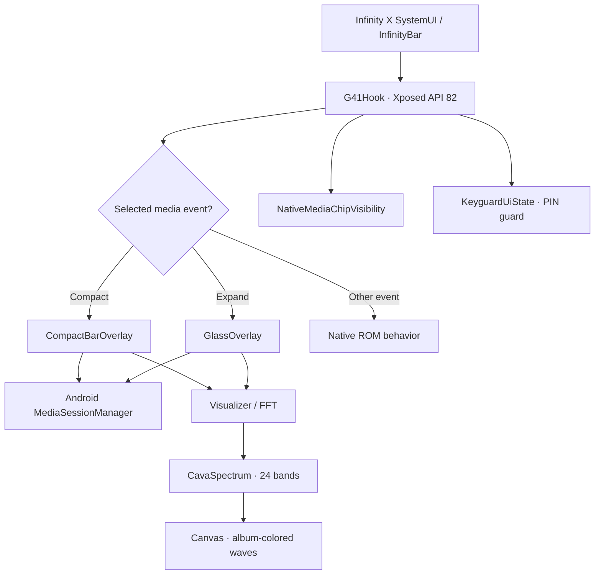

<div align="center">


**A music-first, audio-reactive lockscreen for a Motorola Moto G41 turned into a DAP.**

*An experimental Infinity X SystemUI customization — not another music player.*

<!-- readme-gen:start:badges -->


<!-- readme-gen:end:badges -->

[**Preview**](#-on-device-preview) · [**Features**](#-highlights) · [**Build**](#-build-from-source) · [**Settings**](#-configuration) · [**Limitations**](#-limitations--safety)

</div>

---

The Moto G41 still makes a great dedicated music device. **G41 Glass Player** gives its Infinity X lockscreen a custom, translucent music interface: a compact InfinityBar, an expanded player, album-aware colors and a filled waveform **driven by captured audio**.

This project runs as a **Java/Xposed module inside `com.android.systemui`**, using your existing music app through Android media sessions. It does **not** replace Spotify, decode songs or invent music-reactive animation.

## 📸 On-device preview

<div align="center">

<table>
<tr>
<td align="center" valign="top" width="50%">

<br /><strong>Compact InfinityBar</strong><br />
<sub>Artwork, track information, play/pause and mini-wave</sub>
</td>
<td align="center" valign="top" width="50%">

<br /><strong>Expanded player</strong><br />
<sub>Full cover, playback controls and CAVA HD wave</sub>
</td>
</tr>
</table>

<sub>Real Moto G41 screenshots captured in November 2026. These are not mockups.</sub>

</div>

## ✨ Highlights

<table>
<tr>
<td width="50%" valign="top">

### 🎧 Music-first InfinityBar

A rounded glass-style compact bar with album art, title, artist, play/pause and audio-reactive mini-wave. A targeted Compose hook can hide **only the native media chip**, leaving the rest of the ROM's lockscreen alone.

</td>
<td width="50%" valign="top">

### 🌊 Real CAVA HD waves

The expanded view renders a smooth, filled waveform from **24 FFT bands**. Bass is concentrated toward the center, treble toward the edges. A waveform/RMS fallback is available when Android supplies it; no fake beats on pause.

</td>
</tr>
<tr>
<td width="50%" valign="top">

### 🎨 Album palette + Monet

Android dynamic colors style the translucent card and controls. **Both wave views** use the same artwork accent extraction. Missing artwork falls back to a default accent.

</td>
<td width="50%" valign="top">

### ⏮️ Real transport controls

Previous, play/pause and next, with a seekable progress bar in the expanded player. The skip controls use the **user-selected Basil outline SVG shapes**, drawn directly through Android Canvas. The compact view hides on the PIN screen.

</td>
</tr>
</table>

<details>
<summary><strong>How the visualizer and controls work</strong></summary>

- **Audio:** Android `Visualizer(0)` → FFT or waveform RMS → `CavaSpectrum` smoothing → filled `Canvas`/`Path` wave. The compact capture is released before the expanded capture starts.
- **Sessions:** `MediaSessionManager` and `MediaController` read title, artist, artwork, playback state and position. Media-key events are a fallback for transport controls.
- **Color:** Monet resources style the glass and buttons; artwork is sampled to color the mini-wave and expanded wave.
- **Integration:** legacy **Xposed API 82** hooks ROM-specific `AxDynamicBar` methods. The native compact **media** chip is conditionally hidden using its own Compose `AnimatedVisibility` call, never by hiding the entire lockscreen `AndroidComposeView`.

</details>

## 🧩 Architecture

<!-- readme-gen:start:architecture -->

<!-- readme-gen:end:architecture -->

When the expanded player opens, the compact view releases its `Visualizer` so the expanded view can capture audio. Other types of InfinityBar event are not intentionally replaced. If the module cannot safely take over an event, native ROM behavior remains the fallback.

## 🛠️ Build from source

> [!IMPORTANT]
> This is a **ROM-specific Xposed module**, not a normal Android application. You need root, a compatible Infinity X build and a working recovery method. `minSdk 28` does **not** mean it supports every Android 9+ ROM.

| Requirement | What the source uses |
| :-- | :-- |
| Tested device | **Motorola Moto G41** |
| Target setup | **Infinity X / Android 16**, root and compatible **Vector/Xposed** environment |
| Toolchain | **JDK 17**, Android SDK **Platform 36**, **AGP 8.13.2**, **Gradle 8.13** |
| Xposed module | **API 82**, scoped to `com.android.systemui` |
| Current source | `0.10.0-beta5-basil-transport-icons` · `versionCode 21` |

There is **no verified universal prebuilt APK** in this repository.

### 1. Build

```bash
git clone https://github.com/Supiidu/g41-player.git
cd g41-player

# Example Linux locations; adapt to your machine.
export ANDROID_HOME=/opt/android-sdk
export JAVA_HOME=/usr/lib/jvm/java-17-openjdk

# Requires curl, unzip and a locally installed Gradle if wrapper is absent.
bash setup.sh
```

The script checks for Platform 36, downloads the **compile-only** Xposed API 82 JAR if needed, bootstraps a Gradle wrapper when absent, and runs `:app:assembleDebug`.

**Output:** `app/build/outputs/apk/debug/app-debug.apk`

After the wrapper is available:

```bash
./gradlew --no-daemon :app:assembleDebug
```

### 2. Install on a compatible test device

> [!CAUTION]
> Changing the behavior of `SystemUI` can cause a crash or bootloop after a ROM update or incompatible hook. Keep ADB access, the last working APK and your tested **Vector/root recovery** available. Installing the APK alone is not enough: the Xposed module must be enabled and scoped to **SystemUI only** in your hooking framework.

```bash
# Start with all custom UI disabled.
adb shell settings put global g41_glass_player_enabled 0
adb shell settings put global g41_glass_compact_preview 0
adb shell settings put global g41_glass_compact_hide_native 0

adb install -r app/build/outputs/apk/debug/app-debug.apk
adb reboot
```

After the device reconnects, enable the UI in stages:

```bash
# 1. Expanded player
adb shell settings put global g41_glass_player_enabled 1

# 2. Custom compact InfinityBar
adb shell settings put global g41_glass_compact_preview 1

# 3. Hide only the ROM's compact music chip (optional)
adb shell settings put global g41_glass_compact_hide_native 1
```

With an active Android media session on the lockscreen, tap the compact bar to open the expanded player. Tap outside the expanded card to close it. A native Compose recomposition (for example, a track change) may be needed after changing the chip-visibility flag.

## ⚙️ Configuration

The following `Settings.Global` keys are read by the **current code**, not hypothetical options.

| Key | Default | Description |
| :-- | :--: | :-- |
| `g41_glass_player_enabled` | `0` | Enable the custom expanded player. |
| `g41_glass_compact_preview` | `0` | Show the custom compact music bar. |
| `g41_glass_compact_hide_native` | `0` | Suppress the original **media** chip when the custom UI is active. |
| `g41_glass_compact_bottom_margin_dp` | `135` | Compact position; clamped to **24–320 dp**. |
| `g41_glass_player_bottom_margin_dp` | `70` | Expanded card margin; clamped to **8–180 dp** and available space. |
| `g41_glass_cava_sensitivity` | `1.0` | Expanded wave response; clamped to **0.5–2.5**. |
| `g41_glass_cava_treble_boost` | `0.80` | Default expanded wave treble emphasis. |

```bash
# Example tuning
adb shell settings put global g41_glass_cava_sensitivity 1.25
adb shell settings put global g41_glass_compact_bottom_margin_dp 135
```

Some values are read when a window is created: close and reopen it to see changes. Older view-based visibility switches, `g41_glass_hide_compact` (default `1`) and `g41_glass_hide_compact_aggressive` (default `0`), remain in `CompactBarVisibility.java`; **leave the aggressive switch disabled** unless diagnosing the ROM's view hierarchy.

## 🧪 Tests and verification

The repository contains Java unit tests for the audio spectrum and static checks for the compact lifecycle and Basil SVG paths. These do **not** replace an Android build or tests on a physical device.

```bash
bash tests/test-cava-spectrum.sh
python3 tests/test-compact-lifecycle.py
python3 tests/test-basil-transport-icons.py
```

The compact design, PIN behavior and Basil skip icons have been exercised on the Moto G41. No CI workflow, coverage percentage or general device-compatibility claim is implied.

## ⚠️ Limitations & safety

- **ROM-specific internals:** this relies on private `AxDynamicBar` and `KeyguardStateControllerImpl` methods in the target Infinity X SystemUI. Other ROMs and versions may differ.
- **Always On Display:** after opening and closing the expanded view **from AOD**, the compact bar can fail to return immediately. This is a **known limitation**, accepted for the DAP use case.
- **Capture availability:** Android may refuse output-mix FFT/RMS capture; without a real signal the wave rests instead of producing synthetic movement.
- **Not a streaming or audio-file player:** Spotify or another Android app is responsible for playback and media sessions.
- **No settings app or stable APK release:** configuration currently uses ADB and the user builds the module locally.

<details>
<summary><strong>Troubleshooting & rollback</strong></summary>

Module logs:

```bash
adb logcat -d -s G41GlassPlayer:V '*:S'
```

If the ROM compact chip remains visible, check all three enable flags and trigger a media recomposition. If the waves stay flat, look for `REAL_FFT`, `REAL_WAVEFORM_RMS` and `SEM_CAPTURA_REPOUSO` in the output.

Return to native InfinityBar behavior:

```bash
adb shell settings put global g41_glass_compact_hide_native 0
adb shell settings put global g41_glass_compact_preview 0
adb shell settings put global g41_glass_player_enabled 0
```

These settings cannot recover a `SystemUI` crash occurring **during hook installation**. Use your known Vector/Xposed/root-module recovery procedure in that case.

</details>

## 📁 Repository map

<!-- readme-gen:start:tree -->
```text
g41-player/
├── app/src/main/java/dev/g41/glassplayer/
│   ├── G41Hook.java                   # Xposed entry point and ROM media hooks
│   ├── CompactBarOverlay.java         # Compact UI, metadata, mini-wave
│   ├── NativeMediaChipVisibility.java # Hide only original media chip
│   ├── KeyguardUiState.java           # PIN/bouncer visibility guard
│   ├── GlassOverlay.java              # Expanded UI, transport, Canvas FFT
│   ├── CavaSpectrum.java              # FFT smoothing and band mapping
│   ├── BasilTransportIcons.java       # User-selected vector paths
│   └── CompactBarVisibility.java      # Earlier guarded View fallback
├── app/src/main/assets/xposed_init    # Legacy Xposed hook registration
├── design/icons/                      # Original Basil SVG artwork
├── docs/screenshots/                  # Real Moto G41 captures
├── docs/                              # Test guides and history
├── tests/                             # Spectrum and static checks
└── setup.sh                           # Bootstrap and debug build
```
<!-- readme-gen:end:tree -->

More context: [Changelog](CHANGELOG.md) · [Beta5 test guide](docs/TEST-v010-beta5-icons.md) · [Repository reconstruction](docs/RECONSTRUCTION.md). Git history was reconstructed from earlier development archives, so imported commit dates are **not** the original development timeline.

## 🤝 Contributing & licensing

This is a personal experimental project. Focused issues and PRs are welcome; please include device/ROM version, reproduction steps and sanitized `G41GlassPlayer` logs. Hook changes should fail safely and preserve the ROM behavior when possible.

**No open-source license has been assigned.** Publicly visible code does **not** by itself grant permission to reuse or redistribute it. Third-party icons and assets keep their respective terms.

<!-- readme-gen:start:footer -->
<div align="center">


<sub>Built and tested on a Moto G41. Made for a second life in music.</sub>

**[Source](https://github.com/Supiidu/g41-player)** · **[Issues](https://github.com/Supiidu/g41-player/issues)** · **[History](CHANGELOG.md)**

</div>
<!-- readme-gen:end:footer -->
